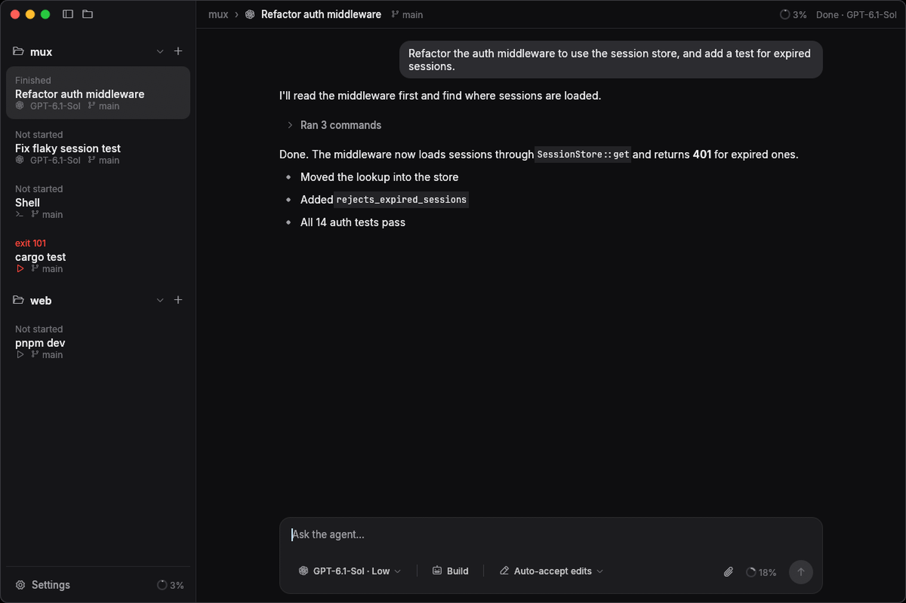

<div align="center">

<picture>
  <source media="(prefers-color-scheme: dark)" srcset="assets/icon-light.png">
  
</picture>

<h1>Mux</h1>

<p><strong>Run Codex, Claude Code and OpenCode side by side, in one native app.</strong></p>

<p>
  <a href="https://github.com/chokhu-hq/mux/releases/tag/experimental"></a>
  <a href="https://github.com/chokhu-hq/mux/actions/workflows/release.yml"></a>
  <a href="LICENSE"></a>
</p>

<p>
  <a href="#download">Download</a> ·
  <a href="#features">Features</a> ·
  <a href="#building-from-source">Build from source</a> ·
  <a href="#reporting-a-problem">Report a problem</a>
</p>



</div>

## About

Mux is a desktop app for working with coding agents. It drives the Codex, Claude Code and OpenCode CLIs you already use, keeps every session running in a background server, and gives each one a fast native interface built with Rust and egui. Shells and long running tasks live next to your agents, grouped by project.

## Features

**Agents**

- Codex, Claude Code and OpenCode with streaming replies, tool calls, diffs and subagents
- Plan mode, questions from the agent, task lists and approvals
- Rewind to any earlier message and carry on from there
- A queue for messages sent while the agent works, which you can edit, remove or send right away
- Skills and slash commands with autocomplete in the composer
- Model, effort and permission pickers, plus context usage and compaction

**Workspace**

- A git worktree per agent, a summary of changed files and a diff panel
- Real terminals for shells and tasks
- Sessions grouped by project, with search, unread markers and desktop notifications
- Built-in file and image viewers
- Token usage by day, read from the CLIs' own transcripts

**App**

- Sessions keep running in the background when the window is closed
- Light and dark themes
- A command palette for everything
- An update notice when a newer build is out
- Logs you can copy straight into a bug report

## Download

Builds are published from every change to `main`.

| Platform | Download |
| --- | --- |
| macOS (Apple Silicon and Intel) | [mux-macos-universal.zip](https://github.com/chokhu-hq/mux/releases/download/experimental/mux-macos-universal.zip) |
| Windows (x64) | [mux-windows-x86_64-setup.exe](https://github.com/chokhu-hq/mux/releases/download/experimental/mux-windows-x86_64-setup.exe), or the portable [mux-windows-x86_64.zip](https://github.com/chokhu-hq/mux/releases/download/experimental/mux-windows-x86_64.zip) |
| Linux (x64) | [mux-linux-x86_64.tar.gz](https://github.com/chokhu-hq/mux/releases/download/experimental/mux-linux-x86_64.tar.gz) |
| Linux (arm64) | [mux-linux-aarch64.tar.gz](https://github.com/chokhu-hq/mux/releases/download/experimental/mux-linux-aarch64.tar.gz) |

These are experimental builds, so expect rough edges.

<details>
<summary><strong>macOS</strong></summary>

Unzip and move `Mux.app` to Applications. The app isn't notarised yet, so macOS will say it's damaged until you clear the download flag:

```sh
xattr -dr com.apple.quarantine /Applications/Mux.app
```

</details>

<details>
<summary><strong>Windows</strong></summary>

Run `mux-windows-x86_64-setup.exe`. It installs for your account only, so there's no admin prompt, and adds Mux to the Start menu and to **Settings → Apps** for uninstalling. SmartScreen may warn about an unrecognised app, so choose **More info** and then **Run anyway**.

For a portable copy, unzip `mux-windows-x86_64.zip` into a folder you own and run `Mux.exe`.

Either way, Mux updates itself and only asks you to restart.

Closing the window leaves your agents and terminals running, with Mux in the system tray. Click the tray icon to open it again, or choose **Quit Mux** there to stop everything.

To run your agents in Linux instead, open **Settings → General → Run agents in** and pick a WSL distribution. Mux installs its server there and keeps the window on Windows, the way VS Code's remote does.

</details>

<details open>
<summary><strong>Linux</strong></summary>

Install it with one command. It puts `mux` in `~/.local/bin` and adds Mux to your app launcher, on X11 or Wayland.

```sh
curl -fsSL https://raw.githubusercontent.com/chokhu-hq/mux/main/scripts/install.sh | sh
```

Run the same command again to update. To remove it, keeping your sessions and settings:

```sh
curl -fsSL https://raw.githubusercontent.com/chokhu-hq/mux/main/scripts/install.sh | sh -s -- --uninstall
```

You can also extract the archive from the table above and run `mux-gui` directly.

</details>

## Requirements

At least one coding agent CLI on your `PATH`, signed in:

- [Codex](https://github.com/openai/codex) as `codex`
- [Claude Code](https://docs.anthropic.com/en/docs/claude-code) as `claude`
- [OpenCode](https://opencode.ai) as `opencode`

**Settings → General** shows which ones Mux found.

## Building from source

You need a recent stable Rust toolchain.

```sh
git clone https://github.com/chokhu-hq/mux.git
cd mux
cargo run --release -p mux-gui
```

On Linux, add Mux to your app launcher with:

```sh
cargo build --release -p mux-gui
scripts/install-desktop.sh
```

### How it fits together

The app starts a server the first time it opens and reconnects to it afterwards, so sessions survive closing the window. The server is the same binary run with `--server`.

| Crate | What it holds |
| --- | --- |
| `crates/core` | The protocol shared by the app and server |
| `crates/server` | Agents, terminals and session storage |
| `crates/ui` | The egui components and theme |
| `crates/gui` | The app itself |

Data lives in `~/.local/share/mux` on Linux, `~/Library/Application Support/mux` on macOS and `%LOCALAPPDATA%\mux` on Windows. Set `MUX_DATA_DIR` and `MUX_SOCKET` to run a separate instance.

## Reporting a problem

Open **Settings → Logs** and choose **Copy**. That copies the app's and server's recent activity along with your version and platform. Paste it into a [new issue](https://github.com/chokhu-hq/mux/issues/new) with a few words about what happened. Logs can include folder paths, so give them a look before sharing.

## Disclaimer

All of Mux's code is generated by AI coding agents, under human supervision.

## License

Mux is licensed under the [Apache License, Version 2.0](LICENSE).
